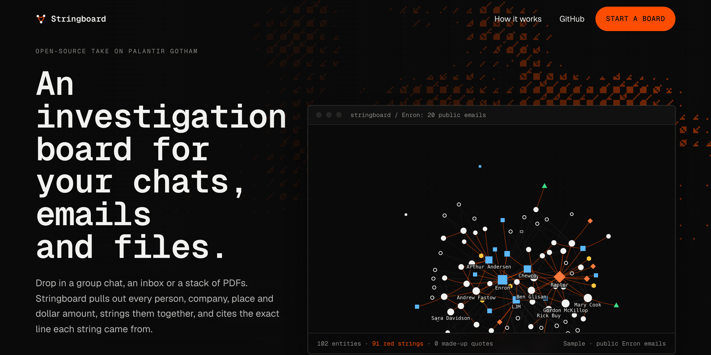
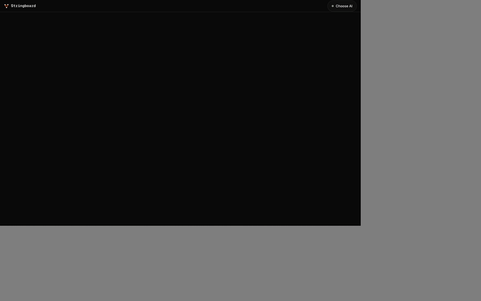

<div align="center">



# Stringboard

**Drop in your chats, emails and files. Get an investigation board of everyone and everything in them**

[**Live app →**](https://stringboard.vedantsoni.com) &nbsp;·&nbsp; [Watch the demo](docs/media/demo.mp4) &nbsp;·&nbsp; [Report a bug](https://github.com/VedSoni-dev/stringboard/issues)

[](LICENSE)
[](https://stringboard.vedantsoni.com)
[](https://github.com/VedSoni-dev/stringboard/stargazers)

</div>



## What it does

<!-- WHAT_IT_DOES: 3–5 bullets, each a thing a person can do, in plain words. No feature-speak. -->

## Bring your own AI

No account with us. Pick what powers it, and switch any time:

| Mode | How | Works on |
|---|---|---|
| **Local model** | Ollama or LM Studio on your computer. Free, private, offline. | your computer |
| **Claude API key** | Paste your Anthropic key. Stored encrypted on your browser only. | web + your computer |
| **publik** | Sign in with publik and use your publik plan. No key. | web + your computer |
| **ChatGPT plan** | Continue with ChatGPT and use your Plus or Pro plan. No API key. | your computer |

## Run it yourself

```bash
git clone https://github.com/VedSoni-dev/stringboard.git
cd stringboard
npm install
npm run dev
```

Open http://localhost:3000. Requires Node 20.9 or newer. Nothing to configure: choose a mode in the app.

## Screenshots

<table>
  <tr>
    <td></td>
    <td></td>
  </tr>
  <tr>
    <td></td>
    <td></td>
  </tr>
</table>

## How it works

<!-- HOW_IT_WORKS: 1 short paragraph + the main files. -->

| Path | What |
|---|---|
| `app/page.tsx` | The landing page |
| `app/app/` | The app |
| `app/api/ai/route.ts` | The AI call (prompts live here) |
| `kit/` | Shared studio kit: the four AI modes, the mode picker, theme and motion tokens |
| `studio.config.ts` | Name, links and which AI modes this app offers |

**Privacy.** Your Claude key is kept in an encrypted, http-only cookie on your browser and sent only to Anthropic. ChatGPT sign-in tokens stay on your computer in `~/.config/stringboard/` (owner-only). Local models never leave your machine. The app sends an anonymous usage count to [Vedant's builds hub](https://builds.vedantsoni.com) (this app's name, which AI mode answered, a random id per browser; no content, no IP, no account), and never for browsers with Do Not Track or Global Privacy Control.

## Contributing

Issues and pull requests are welcome. For a bigger change, open an issue first so we can talk about it.

## License

[MIT](LICENSE) © Vedant Soni

<div align="center">
<sub>Built in public by <a href="https://instagram.com/vedanttalksai">@vedanttalksai</a>. More builds at <a href="https://vedantsoni.com">vedantsoni.com</a>.</sub>
</div>
