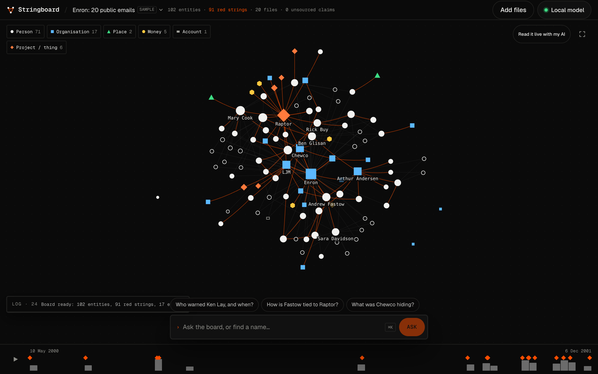
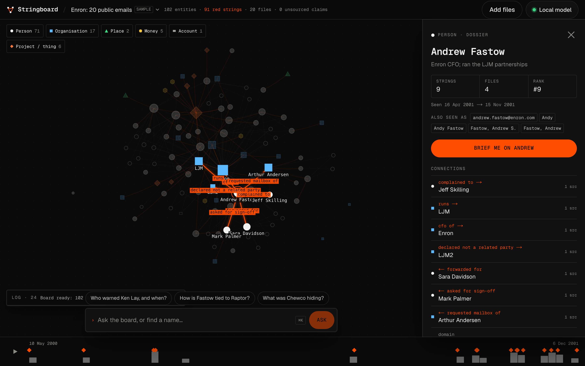
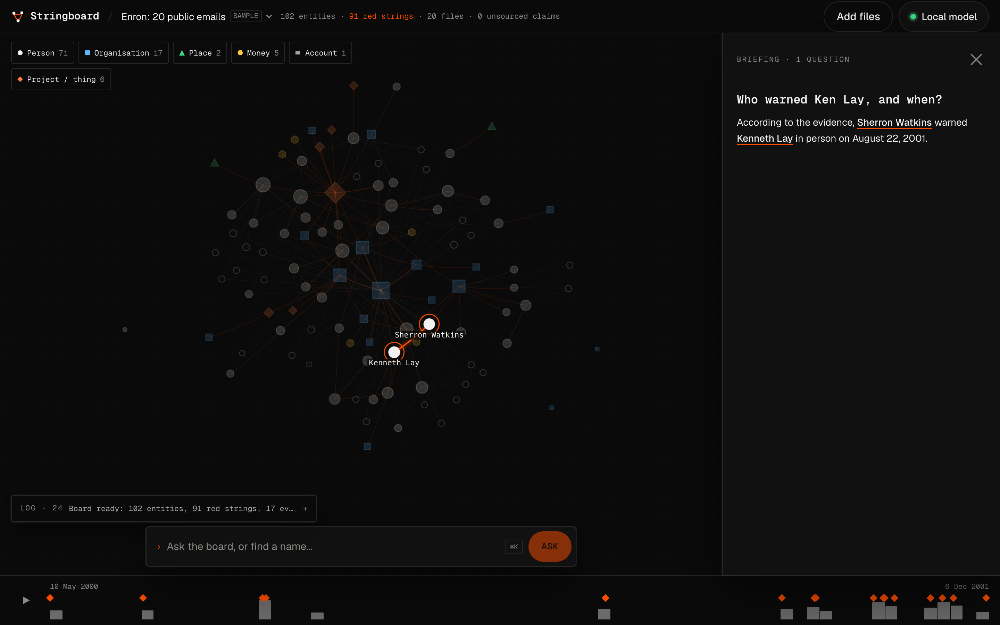
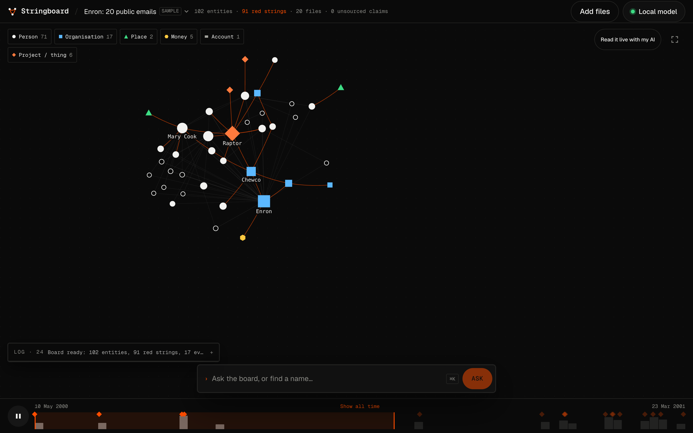

<div align="center">


# Stringboard

**An investigation board for your chats, emails and files.** An open-source take on the link analysis in Palantir Gotham, for normal people.

[**Live app →**](https://stringboard.vedantsoni.com) &nbsp;·&nbsp; [Watch the demo](docs/media/demo.mp4) &nbsp;·&nbsp; [Report a bug](https://github.com/VedSoni-dev/stringboard/issues)

[](LICENSE)
[](https://stringboard.vedantsoni.com)
[](https://github.com/VedSoni-dev/stringboard/stargazers)

</div>


## What it does

- **Drop in anything.** WhatsApp exports, Telegram and Instagram/Messenger JSON, `.eml` / `.mbox`, PDFs, CSV bank statements, or pasted text.
- **Watch the board build.** Every person, company, place, money amount and project becomes a node; who-did-what-to-whom becomes a red string. Who-emails-whom shows up instantly from the headers, before any AI runs.
- **Click any string to see its source.** The model must quote your file word for word; Stringboard checks every quote against the original and drops anything it can't find.
- **Open a dossier.** Aliases it merged ("Fastow, Andrew S." = "Andy" = andrew.fastow@…), connections, a timeline, a pattern-of-life heatmap of when someone messages, and every line they're in.
- **Ask the board.** "Who owes money to whom?" The answer lights up the path on the graph and cites its sources. Scrub the timeline to rewind the board, or press play to watch it grow.

Try it without any files: **Open the Enron sample**, 20 real emails from the public Enron corpus (FERC release, 2003).

## Bring your own AI

No account with us. Pick what powers it, and switch any time:

| Mode | How | Works on |
|---|---|---|
| **OpenRouter key** | Paste your OpenRouter key and pick DeepSeek, Qwen, Kimi or GLM. Cents per board. Stored encrypted on your browser only. | web + your computer |
| **Local model** | Ollama or LM Studio on your computer. Free, private, offline. | your computer |
| **Claude API key** | Paste your Anthropic key. Stored encrypted on your browser only. | web + your computer |
| **publik** | Sign in with publik and use your publik plan. No key. | web + your computer |

## Run it yourself

```bash
git clone https://github.com/VedSoni-dev/stringboard.git
cd stringboard
npm install
npm run dev
```

Open http://localhost:3000. Requires Node 20.9 or newer. Nothing to configure: choose a mode in the app.

## Screenshots

<table>
  <tr>
    <td></td>
    <td></td>
  </tr>
  <tr>
    <td></td>
    <td></td>
  </tr>
</table>

## How it works

Files are parsed in your browser (`lib/parse.ts`). The headers give an instant who-talks-to-whom graph (`addMetadata` in `lib/board.ts`). Then the text goes to your AI in chunks (`app/api/extract/route.ts`), which returns entities, links and events, each with a quote. `mergeExtraction` keeps only facts whose quote is really in the file, and resolves names into one entity (`lib/names.ts`). Boards are saved in IndexedDB on your browser (`lib/store.ts`), never on a server. Questions go to `app/api/ask/route.ts` with the board and the most relevant quotes; the answer marks entities and sources, which the UI turns into lit strings and clickable citations. Small local models get a simpler extraction format they can actually follow.

| Path | What |
|---|---|
| `app/page.tsx` | The landing page (its hero is the real board building the Enron sample) |
| `app/app/page.tsx` | The board app: graph, dossier, briefing, timeline, ask bar |
| `components/board/Graph.tsx` | The force-directed board on one canvas (d3-force) |
| `app/api/extract/route.ts` | Reading a chunk: the extraction prompts |
| `app/api/ask/route.ts` | Asking the board |
| `app/api/parse/route.ts` | PDF to text, in memory |
| `lib/` | Parsers, entity resolution, the quote check, storage, the Enron sample |
| `kit/` | Shared studio kit: the four AI modes, the mode picker, theme and motion tokens |
| `studio.config.ts` | Name, links and which AI modes this app offers |

**Privacy.** Your Claude key is kept in an encrypted, http-only cookie on your browser and sent only to Anthropic. Your OpenRouter key is kept the same way and sent only to OpenRouter. Local models never leave your machine. The app sends an anonymous usage count to [Vedant's builds hub](https://builds.vedantsoni.com) (this app's name, which AI mode answered, a random id per browser; no content, no IP, no account), and never for browsers with Do Not Track or Global Privacy Control.

## Credit

Inspired by the link analysis in Palantir Gotham. Stringboard is not affiliated with Palantir and shares no code or design with it. The sample uses emails from the public Enron corpus (released by FERC in 2003; this copy from the `corbt/enron-emails` dataset), with phone numbers removed.

## Contributing

Issues and pull requests are welcome. For a bigger change, open an issue first so we can talk about it.

## License

[MIT](LICENSE) © Vedant Soni

<div align="center">
<sub>Built in public by <a href="https://instagram.com/vedanttalksai">@vedanttalksai</a>. More builds at <a href="https://vedantsoni.com">vedantsoni.com</a>.</sub>
</div>
